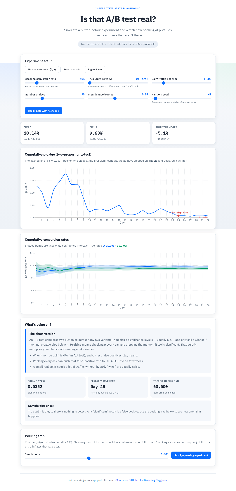
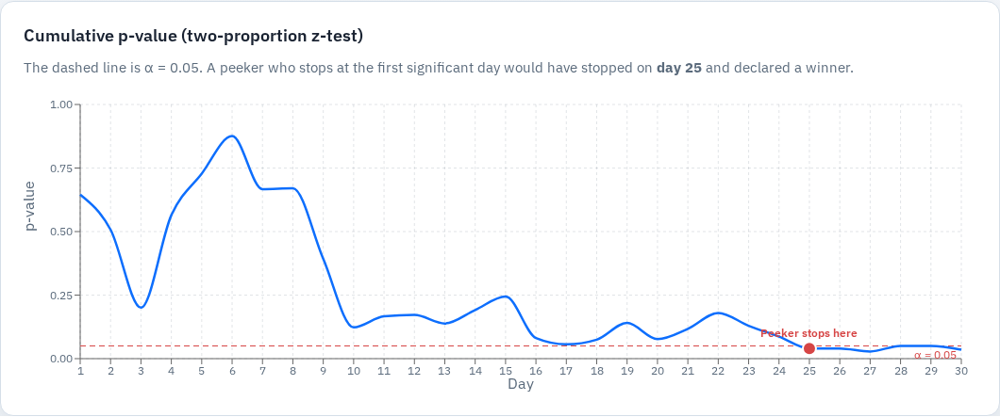
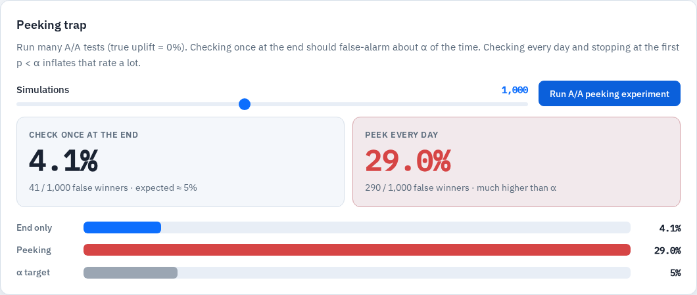
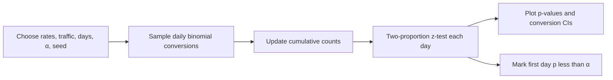

# Is that A/B test real?

Interactive simulator showing why peeking at p-values in A/B tests finds fake winners.

**[Live Demo →](https://fagun98.github.io/ab-test-peeking-simulator/)**



## What it does

You simulate a button-colour A/B test. Pick a baseline conversion rate, the **true** uplift (including 0% for a pure A/A test), daily traffic per arm, number of days, significance level α, and a random seed. The app draws visitors and conversions day by day, then shows:

1. **Cumulative p-value chart** — two-proportion z-test by day, with the α line and a marker on the first day a peeker would have stopped
2. **Conversion-rate chart** — cumulative rates for A vs B with 95% confidence bands
3. **Peeking trap** — thousands of A/A simulations comparing “check once at the end” vs “peek every day”
4. **Plain-English explainer** plus an optional sample-size check (80% power)

Presets: **No real difference (A/A)**, **Small real win**, **Big real win**.

## Screenshots

### P-value chart with peek marker



### Peeking-trap false-positive comparison



## How it works



1. Arm A converts at the baseline rate; arm B at `baseline × (1 + uplift)`.
2. Each day, both arms get the same traffic; conversions are drawn from a binomial.
3. After every day we recompute the cumulative two-sided two-proportion z-test.
4. The **peek day** is the first day the cumulative p-value falls below α.
5. The peeking trap repeats this with uplift = 0 and tallies how often each stopping rule falsely declares a winner.

## The stats, explained

| Idea            | Plain English                                                                                                 |
| --------------- | ------------------------------------------------------------------------------------------------------------- |
| **p-value**     | Under “no difference,” how surprising is the observed gap?                                                    |
| **α**           | How often you’re willing to crow a fake winner if you only check **once** at the end (often 5%).              |
| **Peeking**     | Checking every day and stopping at the first “significant” result. That inflates false positives far above α. |
| **A/A test**    | True uplift is 0%. Any significant call is a false positive — perfect for measuring the peeking trap.         |
| **Sample size** | Visitors needed per arm to detect the chosen uplift with ~80% power at your α.                                |

All formulas live in TypeScript (`src/lib/stats.ts`): seeded Mulberry32 PRNG, `erf` / normal CDF & quantile, binomial sampling, pooled two-proportion z-test, Wald CIs, and a power-based sample-size calculator. Vitest checks them against known values.

## Tech stack

- React 18 + TypeScript
- Vite
- Recharts
- Vitest
- ESLint + Prettier
- Web Worker for the peeking-trap Monte Carlo
- GitHub Actions CI + GitHub Pages deploy

## Project structure

```
ab-test-peeking-simulator/
├── src/
│   ├── components/           # Controls, charts, explainer, peeking trap
│   ├── lib/
│   │   ├── stats.ts          # Stats from scratch
│   │   └── stats.test.ts
│   ├── workers/
│   │   └── peekingTrap.worker.ts
│   ├── App.tsx
│   └── App.css
├── docs/screenshots/         # Real UI screenshots
├── scripts/capture-screenshots.mjs
├── .github/workflows/
│   ├── ci.yml
│   └── deploy.yml
├── package.json
├── vite.config.ts            # base: /ab-test-peeking-simulator/
└── README.md
```

## Local development

### Prerequisites

- Node.js 18+ and npm

### Install & run

```bash
npm install
npm run dev
# open http://localhost:5173/ab-test-peeking-simulator/
```

### Quality checks

```bash
npm run typecheck
npm test
npm run lint
npm run format:check
npm run build
npm run preview
```

### Screenshots

With a preview server running on port 4173:

```bash
npm run build && npm run preview -- --host 127.0.0.1 --port 4173
# in another terminal:
npm run screenshots
```

## Deployment

On every push to `main`, GitHub Actions builds the site and deploys with `actions/configure-pages`, `actions/upload-pages-artifact`, and `actions/deploy-pages` to:

**https://fagun98.github.io/ab-test-peeking-simulator/**

## Inspiration

- [LLM Decoding Playground](https://fagun98.github.io/llm-decoding-playground/)
- [Jev-vs-LLM](https://github.com/fagun98/Jev-vs-LLM)

## License

MIT License — see [LICENSE](LICENSE).

---

Built for the LinkedIn community — no backend, no API keys, just browser-based learning about experiment design.
